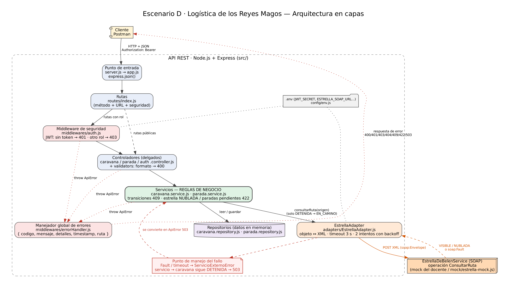

# 🐪 Parcial 1 · Escenario D — Logística de los Reyes Magos

API REST para gestionar las caravanas de Melchor, Gaspar y Baltasar y su itinerario de paradas, integrada con el servicio SOAP heredado **EstrellaDeBelenService**.

- **Estudiante:** Stiven Alexander Panchana Guaranda (N.º 20)
- **Escenario:** D · Reyes Magos
- **Tecnología:** Node.js 18+ · Express 5 · JWT · persistencia en memoria

---

## 1. Cómo levantar el proyecto

Requisitos: **Node.js 18 o superior** (usa `fetch` nativo).

```bash
# 1. Instalar dependencias
npm install

# 2. Crear el archivo de entorno a partir del ejemplo
cp .env.example .env        # en Windows: copy .env.example .env
#    → edita .env y cambia JWT_SECRET por una clave propia
#    → pon en ESTRELLA_SOAP_URL la URL del mock SOAP del docente

# 3. (Opcional) levantar el mock SOAP local en otra terminal
npm run mock                # http://localhost:8088/estrella

# 4. Levantar la API
npm start                   # http://localhost:3000
```

> Los datos viven en memoria: al reiniciar la API se borran. La colección de Postman está pensada para ejecutarse contra una API recién iniciada.

Prueba automática de la colección (con la API levantada):

```bash
npm run test:postman
```

## 2. Variables de entorno

| Variable | Descripción | Ejemplo |
|---|---|---|
| `PORT` | Puerto de la API | `3000` |
| `JWT_SECRET` | Clave para firmar los JWT (**obligatoria, nunca se sube al repo**) | `una_clave_larga` |
| `JWT_EXPIRES_IN` | Vigencia del token | `8h` |
| `ESTRELLA_SOAP_URL` | Endpoint del servicio SOAP (**obligatoria**) | `http://localhost:8088/estrella` |
| `ESTRELLA_SOAP_ACTION` | Header SOAPAction (según el WSDL) | `ConsultarRuta` |
| `ESTRELLA_TIMEOUT_MS` | Tiempo máximo de espera del SOAP | `3000` |
| `ESTRELLA_INTENTOS` | Intentos totales antes de declarar caído el servicio (máx. 2) | `2` |
| `ESTRELLA_BACKOFF_MS` | Espera antes del reintento | `300` |
| `MOCK_PORT` | Puerto del mock SOAP local | `8088` |

El repositorio solo contiene `.env.example`; `.env` está en `.gitignore`.

## 3. Usuarios y tokens de prueba

| Usuario | Clave | Rol | Uso |
|---|---|---|---|
| `jefe` | `jefe123` | `JEFE_CARAVANA` | Puede usar todos los endpoints protegidos |
| `paje` | `paje123` | `PAJE` | Token válido pero sin permiso → **403** |

Obtener un token:

```http
POST /api/auth/login
Content-Type: application/json

{ "usuario": "jefe", "clave": "jefe123" }
```

Se envía en cada petición protegida: `Authorization: Bearer <token>`.
También se pueden generar en consola con `npm run token`.

## 4. Endpoints

| Método | Ruta | Descripción | Seguridad |
|---|---|---|---|
| POST | `/api/caravanas` | Registrar caravana (nace `DETENIDA`) | `JEFE_CARAVANA` |
| GET | `/api/caravanas?estado=` | Listar con filtro | pública |
| GET | `/api/caravanas/{id}` | Detalle con sus paradas | pública |
| PUT | `/api/caravanas/{id}` | Actualizar (solo en `DETENIDA`) | `JEFE_CARAVANA` |
| PATCH | `/api/caravanas/{id}/estado` | Cambiar estado (reglas 1, 2, 3) | `JEFE_CARAVANA` |
| POST | `/api/caravanas/{id}/paradas` | Agregar parada (regla 5) | `JEFE_CARAVANA` |
| GET | `/api/caravanas/{id}/paradas` | Paradas ordenadas por `orden` | pública |
| PATCH | `/api/paradas/{id}/estado` | Marcar `CUMPLIDA` o `CANCELADA` (regla 4) | pública |
| DELETE | `/api/paradas/{id}` | Eliminar (solo `PLANIFICADA`) | `JEFE_CARAVANA` |
| GET | `/api/caravanas/{id}/itinerario` | **Extra:** paradas en orden, días totales y paradas faltantes | pública |

### Códigos de respuesta

| Código | Cuándo |
|---|---|
| 200 / 201 / 204 | Consulta, creación, eliminación correctas |
| 400 | Formato inválido: campos, enums, rangos, JSON mal formado, id no numérico |
| 401 | Sin token o token inválido/expirado |
| 403 | Token válido con un rol distinto a `JEFE_CARAVANA` |
| 404 | La caravana, la parada o la ruta no existen |
| 409 | Transición de estado inválida, rey/ofrenda/orden duplicados, parada anterior pendiente (regla 4), caravana ya en Belén (regla 5), editar una caravana que no está `DETENIDA`, eliminar una parada no `PLANIFICADA` |
| 422 | Estrella `NUBLADA` (regla 2) o paradas `PLANIFICADAS` al pasar a `EN_BELEN` (regla 3) |
| 503 | EstrellaDeBelenService respondió `soap:Fault` o no respondió en 3 s |

Todos los errores usan el mismo formato:

```json
{
  "codigo": "TRANSICION_INVALIDA",
  "mensaje": "No se puede pasar de DETENIDA a OFRENDA_ENTREGADA",
  "detalles": [],
  "timestamp": "2026-12-01T10:15:00.000Z",
  "ruta": "/api/caravanas/1/estado"
}
```

## 5. Arquitectura



Diagrama: [`docs/arquitectura.png`](docs/arquitectura.png) (fuente editable: `docs/arquitectura.dot`).

```
Postman → app.js → routes → [auth middleware] → controllers → services → repositories (memoria)
                                                                  └→ EstrellaAdapter → EstrellaDeBelenService (SOAP)
                         errores lanzados en cualquier capa → errorHandler (formato único)
```

| Capa | Carpeta | Responsabilidad |
|---|---|---|
| Rutas | `src/routes/` | Método + URL + qué rol exige |
| Seguridad | `src/middlewares/auth.js` | Verifica JWT: 401 sin token, 403 con otro rol |
| Controladores | `src/controllers/` | Delgados: validan formato (`src/validators/`), llaman al servicio, eligen el código HTTP |
| Servicios | `src/services/` | **Todas las reglas de negocio**: transiciones, unicidad, orden de paradas, consulta a la estrella |
| Repositorios | `src/repositories/` | Guardar y buscar en memoria, sin reglas |
| Adaptador SOAP | `src/adapters/EstrellaAdapter.js` | Único lugar que conoce XML: arma el `soap:Envelope`, interpreta la respuesta o el `soap:Fault`, timeout de 3 s y reintento con backoff |
| Errores | `src/middlewares/errorHandler.js` | Convierte cualquier error al formato único; nunca expone detalles internos |

**¿Dónde viven las reglas de negocio?** En `src/services/`. Los controladores no deciden nada de negocio.

**¿Qué pasa cuando el SOAP falla?** `EstrellaAdapter` intenta 2 veces (timeout de 3 s cada una, con backoff). Si sigue fallando lanza `ServicioExternoError`. `caravana.service.js` lo captura, **no cambia el estado** (la caravana permanece `DETENIDA`) y responde **503** con el formato estándar. La API nunca responde 500 por culpa del servicio externo.

### Mock SOAP local (`mock/estrella-mock.js`)

| Origen de la caravana | Respuesta del mock | Respuesta de la API al pasar a `EN_CAMINO` |
|---|---|---|
| `Herodes` | `soap:Fault` "Cielo cubierto" | 503 |
| `Nubes` | `NUBLADA` | 422 |
| `Lento` | tarda 5 s (timeout) | 503 |
| cualquier otro | `VISIBLE`, 3 días | 200 |

`Herodes` es el mismo disparador del mock del docente. `Nubes` y `Lento` solo existen en el mock local.

### Decisiones de diseño

- Rey, ofrenda y `orden` duplicados responden **409** (conflicto con un recurso existente).
- Regla 4: la "parada n − 1" es la parada inmediatamente anterior según `orden`, aunque haya saltos en la numeración.
- Una parada solo pasa de `PLANIFICADA` a `CUMPLIDA` o `CANCELADA`; cualquier otro cambio responde 409.
- En el itinerario, `diasTotalesViaje` suma los días de las paradas que no están canceladas.

## 6. Colección de Postman

Archivo: [`postman/ReyesMagos.postman_collection.json`](postman/ReyesMagos.postman_collection.json)

Ejecútala en orden (Runner de Postman o `npm run test:postman`). Los tokens y los ids se guardan solos en variables de la colección.

| Carpeta | Casos |
|---|---|
| 0 · Autenticación | login de `jefe` y `paje` |
| 1 · Creación y consulta | 201 y 200 |
| 2 · Entrada inválida | 400 |
| 3 · Recurso inexistente | 404 |
| 4 · Seguridad | 401 y 403 |
| 5 · Conflictos | 409 (transición inválida, duplicados, regla 4) |
| 6 · SOAP caído | 503 con origen `Herodes`, y la caravana sigue `DETENIDA` |
| 7 · Flujo completo | 422 por regla 3 y recorrido hasta `OFRENDA_ENTREGADA` |
| 8 · Eliminar parada | 204 |
| 9 · Solo con el mock local | 422 por estrella `NUBLADA` |

## 7. Respuesta: ¿y si fueran microservicios?

Separaría dos servicios. **Caravanas** sería dueño de las caravanas, su máquina de estados y la integración con la Estrella (detrás del adaptador). **Itinerarios** sería dueño de las paradas y de la regla de cumplirlas en orden. Cada uno tendría su propia base de datos. Caravanas no leería la tabla de paradas: le preguntaría a Itinerarios por HTTP si quedan paradas `PLANIFICADAS`.

Si Itinerarios cae el 24 de diciembre a las 23:00, Caravanas seguiría consultando, editando y poniendo en camino caravanas. Pero no podría comprobar la regla 3, así que respondería 503 a `EN_BELEN` tras un timeout corto, y la caravana seguiría `EN_CAMINO` en lugar de aprobar la llegada a ciegas. Si cae Caravanas, Itinerarios no podría validar que la caravana existe ni su estado, y rechazaría nuevas paradas con 503. Aun así podría seguir marcando paradas cumplidas, porque esos datos son suyos.
